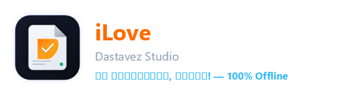
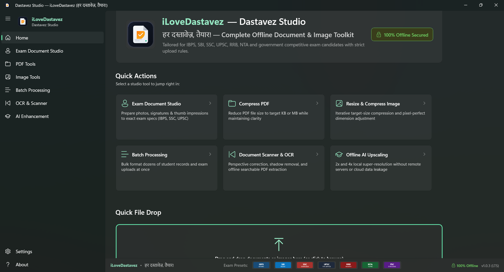
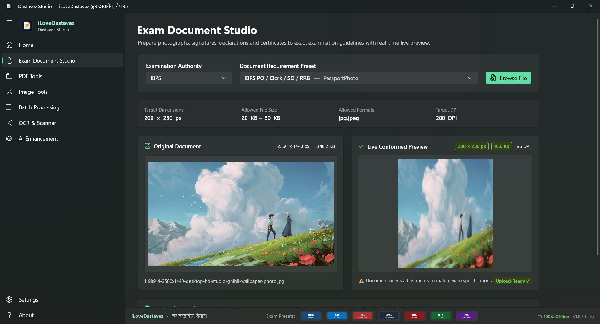
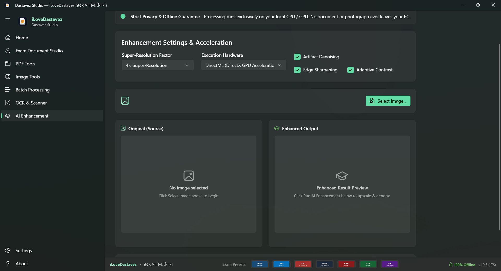

<div align="center">



# Dastavez Studio (iLoveDastavez)
### *हर दस्तावेज़, तैयार! — Complete 100% Offline Document & Image Toolkit for Windows*

[](https://github.com/mohitbhatt-du/iLoveDastavez/releases/latest)
[-0078D6?logo=windows)](https://github.com/mohitbhatt-du/iLoveDastavez/releases/latest)
[](https://dotnet.microsoft.com/)
[](https://learn.microsoft.com/en-us/windows/apps/winui/winui3/)
[](#-why-offline-matters-the-critical-threat-of-document--pii-leakage)
[](docs/PRIVACY_AUDIT.md)
[](https://github.com/mohitbhatt-du/iLoveDastavez/actions/workflows/ci.yml)
[](LICENSE)

<p align="center">
  <b>Tailored for IBPS, SBI, SSC, UPSC, RRB, NTA, and State PSC competitive exam candidates with strict upload rules.</b><br>
  No cloud uploads. No account required. No data leakage. 100% private, air-gapped, and runs locally on your PC.
</p>

[**⬇️ Download Windows Installer (v1.0.3)**](https://github.com/mohitbhatt-du/iLoveDastavez/releases/download/v1.0.3/DastavezStudio-Setup.exe) •
[**📦 Download Portable ZIP (v1.0.3)**](https://github.com/mohitbhatt-du/iLoveDastavez/releases/download/v1.0.3/DastavezStudio-v1.0.3-Portable-win-x64.zip) •
[**🚀 All Releases**](https://github.com/mohitbhatt-du/iLoveDastavez/releases) •
[**🛡️ Why Offline Matters**](#-why-offline-matters-the-critical-threat-of-document--pii-leakage) •
[**✨ Features**](#-core-feature-modules)

</div>

<br>

<div align="center">
  
  <p><i>Dastavez Studio Fluent Desktop Shell — Home Dashboard with Quick Actions, Drag-and-Drop Zone, and Exam Authority Presets</i></p>
</div>

---

## 📌 Overview

**Dastavez Studio** (by **iLoveDastavez**) is an enterprise-grade, privacy-first desktop application designed for Windows 10 and Windows 11. Built from the ground up with C# and .NET 10 LTS WinUI 3 (Windows App SDK), it solves a massive daily struggle faced by over 50 million students, government job applicants, and citizens across India: **strict, unforgiving document upload specifications**.

Applying for competitive examinations (such as UPSC Civil Services, SSC CGL/CHSL, IBPS PO/Clerk, SBI, RRB Railways, NTA JEE/NEET, and State PSCs) requires meeting stringent digital criteria:
- **Precise Pixel Dimensions:** Exactly 200 × 230 px for photos, 140 × 60 px for signatures.
- **Narrow File Size Windows:** Must fall strictly between 20 KB and 50 KB (or 10 KB to 20 KB).
- **Format & DPI Constraints:** JPEG/JPG with 200 DPI resolution headers and clean white backgrounds.
- **Document Scans:** PDFs of marksheets, income/caste certificates capped at 300 KB.

A single non-compliant dimension or oversized kilobyte leads to instant portal rejection. **Dastavez Studio eliminates this frustration through 1-click official presets, iterative binary-search compression, and real-time live preview — entirely offline with zero data leakage.**

---

## 🚨 Why Offline Matters: The Critical Threat of Document & PII Leakage

When faced with portal rejection, millions of desperate applicants turn to free online tools ("compress PDF online", "resize photo to 50KB online", "resize signature online"). **This practice is one of the most rampant vectors for personal identity theft and cybercrime in the digital age.**

```
┌────────────────────────────────────────────────────────────────────────────────────────┐
│                        THE DANGEROUS CYCLE OF ONLINE CONVERTERS                        │
└────────────────────────────────────────────────────────────────────────────────────────┘
  Applicant Uploads:                                Third-Party Cloud Risks:
  • Aadhaar / PAN Cards        ───────────────►     • Indefinite cloud storage retention
  • Passport Photographs                            • Unsecured public Amazon S3 buckets
  • High-Res Signatures                             • Identity theft & SIM swap fraud
  • Left Thumb Impressions                          • Forgery of bank cheques & loan papers
  • Caste & Income Proofs                           • Telemarketing data dumps & dark web leaks
```

### The Anatomy of the Threat:
1. **Biometric & Signature Cloning:**
   A handwritten signature or Left Thumb Impression (LTI) uploaded to a cloud converter is easily vectorized and harvested. Threat actors use these stolen biometrics to forge banking instruments, real estate transfers, fraudulent affidavits, and unauthorized loan agreements.
2. **KYC & Identity Theft:**
   Aadhaar cards, PAN cards, and voter identity proofs contain full legal names, parentage, biometric photographs, residential addresses, and national identity numbers. In the hands of malicious third parties, these documents are utilized to construct *synthetic identities* and pass digital KYC verification on unsecured financial apps.
3. **SIM Swap & OTP Redirection Fraud:**
   Stolen government identity documents provide cybercriminals with the exact credentials needed to impersonate victims at telecom retail counters, issuing counterfeit duplicate SIM cards to hijack 2FA SMS tokens and drain bank accounts.
4. **Indefinite Cloud Retention & Data Scrapers:**
   Many "free" online converter websites operate on shoestring infrastructure. User documents are cached in publicly readable server directories or cloud buckets that remain accessible to web scrapers long after the user closes the tab. Furthermore, several offshore conversion sites monetize by selling aggregated candidate directories to commercial third parties.
5. **Regulatory Violations (DPDP Act 2023):**
   India's **Digital Personal Data Protection (DPDP) Act 2023** mandates strict data minimization and purpose limitation for Personally Identifiable Information (PII). Entrusting sensitive citizen identity documents to unvetted cloud intermediaries exposes candidates to grave privacy harms.

### 🛡️ The Dastavez Studio Solution:
* **100% Air-Gapped Operation:** Dastavez Studio runs entirely disconnected from the network. Disconnect your Wi-Fi, unplug your Ethernet, or toggle Airplane Mode — every tool operates at full speed.
* **Ephemeral In-Memory Processing:** Documents are processed in ephemeral memory buffers with zero disk file locking. Temporary working buffers are wiped immediately upon closing.
* **Zero Telemetry & Zero Analytics:** No tracking pings, no Google Analytics, no user fingerprinting, and zero telemetry beacons.
* **Free & Open Source:** Auditable C# code under the MIT License. What you inspect is what you execute.

---

## ✨ Core Feature Modules

### 🎓 1. Exam Document Studio
*Built for 1-click compliance with official Indian government examination notices.*

<div align="center">
  
  <p><i>Exam Document Studio: Real-time side-by-side Live Conformed Preview workbench with automatic specification validation</i></p>
</div>

* **Verified Examination Presets:** Built-in official criteria for **IBPS, SBI, SSC, UPSC, RRB, NTA (NEET/JEE), and State Public Service Commissions**.
* **Supported Document Categories:**
  - Passport Photographs (200 × 230 px, 20–50 KB, 200 DPI)
  - Signatures (140 × 60 px, 10–20 KB, 200 DPI)
  - Left Thumb Impressions / LTI (240 × 240 px, 20–50 KB)
  - Handwritten Declarations (800 × 400 px, 50–100 KB)
  - Certificates & Marksheets (A4 dimensions, 100–300 KB PDF/JPEG)
* **Real-Time Live Conformed Preview:** Side-by-side comparative inspection displaying original vs conformed output with live pixel dimensions and exact file size badges.
* **Automated Compliance Engine:** Instant visual feedback (🟢 Compliant / 🟡 Adjusting / 🔴 Non-compliant) ensuring your upload passes examination portal validators on the first attempt.

---

### 📄 2. Core PDF Toolkit & Multi-Page Live Workbench
*Complete offline PDF manipulation and compression engine powered by PdfSharpCore and Windows native rendering.*

* **Target-KB PDF Compression:** Specify an exact target size (e.g. 300 KB for UPSC / State PSC certificates) with stream-level FlateDecode compression and image downsampling.
* **Multi-Page Live Preview Workbench:** Side-by-side interactive viewer with page navigation controls (`◀ Page X of Y ▶`) rendering pages via `Windows.Data.Pdf.PdfDocument` without locking files on disk.
* **Page Operations:**
  - Merge multiple PDFs into a single continuous file.
  - Split multi-page documents into individual pages or specific ranges.
  - Rotate pages in 90-degree increments.
  - Delete unwanted blank pages.
* **Photos to PDF Converter:** Compile image collections into a clean, searchable, multi-page PDF document.
* **Security & Passwords:** Add robust AES encryption or strip authorized passwords offline.

---

### 🖼️ 3. Core Image Toolkit
*High-precision image processing engine backed by SkiaSharp.*

* **Smart Target-Size Compression:** Iterative binary search algorithm converges rapidly to your requested file size (e.g. strictly ≤ 50 KB) while preserving maximum visual fidelity.
* **Pixel-Perfect Dimension Resizing:** Resize by absolute pixels, percentages, or physical centimeters/inches at specific DPI settings with aspect-ratio preservation.
* **Lossless EXIF & Metadata Stripping:** Automatically removes GPS location coordinates, camera models, and timestamps to protect candidate anonymity.
* **Editing Suite:** Crop, rotate, flip, adjust contrast/brightness, and convert colored scans to uniform grayscale.
* **Universal Formats:** Full read/write support for **JPEG, PNG, WEBP, BMP, and TIFF**.

---

### ⚡ 4. High-Throughput Batch Processing Engine
*Bulk format dozens of student records and exam uploads at once.*

* **Bounded Concurrency Queue:** Powered by `SemaphoreSlim` (configurable 1–8 parallel worker tasks) ensuring smooth high-speed bulk execution without saturating CPU or exhausting RAM.
* **Collision-Safe Renaming:** Automated naming collision prevention (`_001`, `_002`) preserving directory structure.
* **Selective Fault Retry:** Re-run only failed queue items without reprocessing successfully exported files.

---

### 🔍 5. Document Scanner & Offline OCR
*Convert smartphone photos of certificates into professional, flat, searchable PDFs.*

* **Auto-Deskew Correction:** Detects scan skew angles via horizontal projection profiling and straightens documents automatically.
* **Shadow Removal & Lighting Normalization:** Eliminates smartphone hand and ambient shadows from paper certificates.
* **Adaptive Document Binarization:** Converts unevenly lit documents into crisp, high-contrast black-and-white scans.
* **100% Offline OCR:** Extracts words and bounding boxes locally via native `Windows.Media.Ocr`.
* **Searchable PDF Generation:** Embeds an invisible, selectable text layer onto the original image scan for keyword search and accessibility.

---

### 🤖 6. Offline AI Enhancement
*Next-generation image upscaling and noise reduction running locally on your hardware.*

<div align="center">
  
  <p><i>Offline AI Enhancement: 4× super-resolution and artifact denoising powered by local DirectML DirectX GPU acceleration</i></p>
</div>

* **Local Super-Resolution:** 2× and 4× super-resolution upscaling for low-resolution smartphone photographs and old printed marksheets.
* **Hardware Acceleration:** Native DirectML execution across NVIDIA, AMD, and Intel GPUs via DirectX 12 — zero cloud latency, zero data transmission.
* **Artifact Denoising:** Edge-preserving bilateral filtering that removes compression noise while keeping facial features and signatures crisp.

---

### 🎨 7. Appearance Themes & Seamless Updates
*Modern Fluent Design with full user customizability.*

* **Live Dynamic Theme Switcher:** Instant runtime switching between **Follow Windows System Theme**, **Fluent Light Theme**, and **Obsidian Dark Theme** with persistent settings in `%LOCALAPPDATA%\DastavezStudio\settings.json`.
* **Seamless In-App Updater:** Built-in update engine checks the official GitHub Releases API, displays release notes, downloads the new installer with live progress, and applies upgrades cleanly without file locks.

---

## 📋 Official Examination Presets Quick Reference

Dastavez Studio includes pre-configured, verified specifications for major recruitment bodies:

| Authority | Document Type | Dimensions (px) | Dimensions (cm) | Size Limit | DPI | Format |
|---|---|---|---|---|---|---|
| **IBPS** | Passport Photo | 200 × 230 | 4.5 × 3.5 cm | 20 KB – 50 KB | 200 | JPG / JPEG |
| **IBPS** | Signature | 140 × 60 | 3.0 × 1.5 cm | 10 KB – 20 KB | 200 | JPG / JPEG |
| **IBPS** | Left Thumb Impression | 240 × 240 | 3.0 × 3.0 cm | 20 KB – 50 KB | 200 | JPG / JPEG |
| **IBPS** | Handwritten Declaration | 800 × 400 | 10.0 × 5.0 cm | 50 KB – 100 KB | 200 | JPG / JPEG |
| **SBI** | Passport Photo | 200 × 230 | 4.5 × 3.5 cm | 20 KB – 50 KB | 200 | JPG / JPEG |
| **SBI** | Signature | 140 × 60 | 3.0 × 1.5 cm | 10 KB – 20 KB | 200 | JPG / JPEG |
| **SSC** | Photograph | 350 × 450 | 3.5 × 4.5 cm | 20 KB – 50 KB | 200 | JPG / JPEG |
| **SSC** | Signature | 400 × 200 | 4.0 × 2.0 cm | 10 KB – 20 KB | 200 | JPG / JPEG |
| **UPSC** | Photograph | 350 × 350 (min) | 3.5 × 3.5 cm | 20 KB – 300 KB | 300 | JPG / JPEG |
| **UPSC** | Signature | 350 × 350 (min) | 3.5 × 3.5 cm | 20 KB – 300 KB | 300 | JPG / JPEG |
| **UPSC** | Certificate / Proof | A4 / Auto | Standard A4 | ≤ 300 KB | 200 | PDF |
| **RRB** | Photograph | 320 × 240 | 3.5 × 4.5 cm | 30 KB – 70 KB | 200 | JPG / JPEG |
| **RRB** | Signature | 140 × 60 | 3.0 × 1.5 cm | 30 KB – 70 KB | 200 | JPG / JPEG |
| **NTA** | Passport Photo | 400 × 500 | 3.5 × 4.5 cm | 10 KB – 200 KB | 200 | JPG / JPEG |
| **NTA** | Signature | 400 × 150 | 3.5 × 1.5 cm | 4 KB – 30 KB | 200 | JPG / JPEG |

---

## 📥 Installation & Download

### Option 1: Windows Installer (Recommended)
Download the standalone offline installer with desktop shortcut and Start menu integration:
* **[DastavezStudio-Setup.exe](https://github.com/mohitbhatt-du/iLoveDastavez/releases/download/v1.0.3/DastavezStudio-Setup.exe)** (~50.4 MB)

### Option 2: Portable ZIP (No Installation Required)
Extract and run immediately on any PC without administrator privileges:
* **[DastavezStudio-v1.0.3-Portable-win-x64.zip](https://github.com/mohitbhatt-du/iLoveDastavez/releases/download/v1.0.3/DastavezStudio-v1.0.3-Portable-win-x64.zip)** (~76.2 MB)

### Option 3: SHA-256 Checksum Verification
To verify binary integrity:
```powershell
Get-FileHash DastavezStudio-Setup.exe -Algorithm SHA256
```
Compare against official release checksums published in [SHA256SUMS.txt](https://github.com/mohitbhatt-du/iLoveDastavez/releases/download/v1.0.3/SHA256SUMS.txt):
```
1b9e3606b1f0b4a9c6c8439b564c54997c595f53a419fab24ba650ee0ce83fe5  DastavezStudio-Setup.exe
52957e1421ef23e2bf57b616ff67a3714661db764aa0404c177b594f0a794ac0  DastavezStudio-v1.0.3-Portable-win-x64.zip
```

---

## 🏗️ Clean Architecture & Technology Stack

Dastavez Studio adheres to decoupled Clean Architecture principles:

```
DastavezStudio/
├── src/
│   ├── DastavezStudio.App/            # WinUI 3 Modern Desktop Shell (MVVM)
│   ├── DastavezStudio.Core/           # Domain Models, Interfaces, Settings & Updater
│   ├── DastavezStudio.ExamPresets/    # Examination Preset Rules Engine & Catalog
│   ├── DastavezStudio.ImageEngine/    # SkiaSharp High-Fidelity Image Processing Engine
│   ├── DastavezStudio.PdfEngine/      # PdfSharpCore PDF Manipulation Engine
│   ├── DastavezStudio.AiEngine/       # Offline DirectML GPU Super-Resolution Engine
│   ├── DastavezStudio.OcrEngine/      # Document Deskew, Cleaner & Windows Media OCR
│   └── DastavezStudio.Security/       # Ephemeral Session & Non-Locking Memory Manager
├── tests/
│   └── DastavezStudio.UnitTests/      # Automated xUnit Test Suite (26 Tests)
├── packaging/
│   └── installer.iss                  # Inno Setup Packaging Configuration
├── assets/
│   ├── brand_banner.png               # High-Resolution Brand Identity Banner
│   └── screenshots/                   # Application Showcase Screenshots
└── .github/workflows/
    ├── ci.yml                         # Automated Continuous Integration (x64)
    └── release.yml                    # Automated Release Packaging & Checksums
```

### Core Technologies:
* **Language & Runtime:** C# 13, .NET 10.0 LTS
* **UI Framework:** WinUI 3 (Windows App SDK 1.7 / 2.6) with Mica Backdrop & Fluent Design
* **Image Processing:** SkiaSharp 3.116 (Google Skia Graphics Engine)
* **PDF Engine:** PdfSharpCore & native Windows Runtime `Windows.Data.Pdf.PdfDocument`
* **Local OCR:** Windows Runtime `Windows.Media.Ocr`
* **Local AI Acceleration:** Microsoft DirectML & ONNX Runtime (DirectX 12 GPU)
* **Architecture Pattern:** MVVM via CommunityToolkit.Mvvm

---

## 💻 Building from Source

### Prerequisites
* Windows 10 (version 1809 / build 17763 or newer) or Windows 11
* [.NET 10 SDK](https://dotnet.microsoft.com/download/dotnet/10.0)

### Clone & Build
```powershell
# Clone the repository
git clone https://github.com/mohitbhatt-du/iLoveDastavez.git
cd iLoveDastavez

# Restore dependencies
dotnet restore DastavezStudio.slnx

# Run automated unit test suite
dotnet test tests/DastavezStudio.UnitTests/DastavezStudio.UnitTests.csproj -c Release

# Run the desktop application
dotnet run --project src/DastavezStudio.App/DastavezStudio.App.csproj -c Debug
```

---

## 👨‍💻 Creator & Community

**Dastavez Studio** is created and maintained by **Mohit Bhatt**:
* **GitHub Profile:** [@mohitbhatt-du](https://github.com/mohitbhatt-du)
* **Repository:** [mohitbhatt-du/iLoveDastavez](https://github.com/mohitbhatt-du/iLoveDastavez)
* **Issue Tracker:** [Submit Bug / Request New Exam Preset](https://github.com/mohitbhatt-du/iLoveDastavez/issues)

---

## 📄 License & Legal Notice

This software is released under the **[MIT License](LICENSE)**.

*Disclaimer: Examination authority names, acronyms, and marks (IBPS, SBI, SSC, UPSC, RRB, NTA) belong exclusively to their respective governing bodies. Dastavez Studio is an independent open-source productivity toolkit and is not affiliated with, endorsed by, or sponsored by any government organization. Candidate specifications should always be verified against official examination notifications.*
