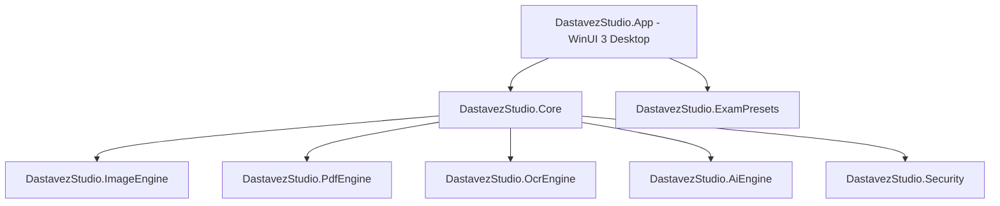

# System Architecture — Dastavez Studio

## Overview
**Dastavez Studio** is a modular, offline-first Windows 10/11 desktop application built using **.NET 10 LTS**, **C#**, and **WinUI 3 (Windows App SDK)**.

## Solution Structure

### 1. `DastavezStudio.App` (WinUI 3 / Windows App SDK)
- **Pattern:** MVVM (Model-View-ViewModel) using CommunityToolkit.Mvvm / Microsoft.Extensions.DependencyInjection.
- **UI:** Microsoft Fluent Design System, Mica backdrops, light/dark theme adaptation, Microsoft Fluent System Icons.
- **Views:**
  - `HomeView`: Quick access cards, file drop target zone, recent tools.
  - `ExamStudioView`: Exam requirement picker, target dimensions, instant visual validator.
  - `ImageToolsView`: Resize, crop, convert, target-size compression, DPI adjustment, EXIF scrubber.
  - `PdfToolsView`: Compress, merge, split, extract, rotate, password lock/unlock.
  - `ScannerOcrView`: Boundary detection, deskew, shadow clean, offline Tesseract OCR.
  - `BatchProcessingView`: Multi-file bounded-concurrency processing with progress bars and queue reporting.
  - `SettingsView`: Theme selection, temporary path cleanup, default DPI and quality preferences.
  - `AboutView`: Version info, licenses, offline disclaimers.

### 2. `DastavezStudio.Core`
- Defines core interfaces: `IImageProcessor`, `IPdfProcessor`, `IExamPresetService`, `IOcrService`, `IAiEnhancer`, `ITempFileManager`.
- Service contracts, models, DTOs, and event notifications.

### 3. `DastavezStudio.ImageEngine`
- Powered by SkiaSharp and SixLabors.ImageSharp.
- Provides precise aspect-ratio resizing, target-size iterative compression, EXIF removal, DPI metadata writing, and format conversion.

### 4. `DastavezStudio.PdfEngine`
- High-fidelity PDF rendering (via PDFium) and manipulation (page extraction, split, merge, compression).

### 5. `DastavezStudio.ExamPresets`
- Hardcoded & configurable verified presets for recruitment authorities:
  - **IBPS:** Photo (200x230 px, 20-50 KB), Signature (140x60 px, 10-20 KB), LTI (240x240 px, 20-50 KB), Declaration (800x400 px, 50-100 KB).
  - **SBI:** PO / Clerk specifications.
  - **SSC:** CGL / CHSL specifications.
  - **UPSC:** Civil Services dimensions and file size bounds.
  - **RRB, NTA, State PSCs**.
- Custom Preset Engine allows users to save any custom criteria.

### 6. `DastavezStudio.OcrEngine`
- Offline document cleanup (perspective correction, thresholding) and local Tesseract OCR.

### 7. `DastavezStudio.AiEngine`
- ONNX Runtime integration for offline 2x/4x super-resolution and image denoising.

### 8. `DastavezStudio.Security`
- Secure temporary directory generation, file sanitization, zero-leak disposal, and cryptographic checksum validation.
